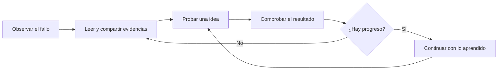
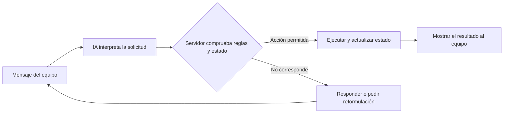
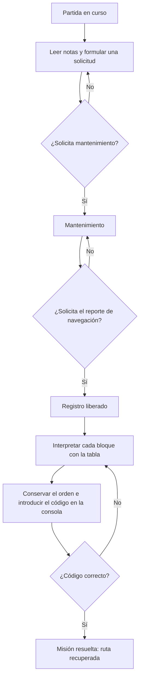

# Una nave también es un sistema

Material didáctico de ACECOM para NORA · NEXUS-404. Público: estudiantes de secundaria, sin conocimientos previos de programación. La actividad conecta la misión con inteligencia artificial y arquitectura de software, entendida como el reparto de responsabilidades entre partes de un sistema.

## Uso de las imágenes

1. **Antes de iniciar el reloj:** proyectar `01-antes-de-jugar.png`. Presentación de aproximadamente dos minutos, sin revelar el camino de resolución.
2. **Durante los quince minutos:** retirar la presentación y dejar la consola del juego. Repartir las cuatro notas o abrir el expediente digital.
3. **Al terminar, hayan ganado o no:** proyectar `02-despues-de-jugar.png`. Cierre de aproximadamente tres minutos. Esta imagen REVELA el recorrido del reto: no distribuirla antes.

Las imágenes son horizontales, 16:9, de 1672 × 941 píxeles. Abrirlas a pantalla completa para proyectar. El texto que sigue también sirve como alternativa accesible a las imágenes. Los prompts originales están en `PROMPTS.md`; se usó la herramienta integrada de generación de imágenes.

## Antes: guion para leer

> Imaginen que esta computadora es la consola de una nave. Un sistema tiene varias partes y cada una cumple una función. La interfaz es donde escribimos y vemos resultados; en la nave es la consola del puente. NORA es la voz con la que conversamos: en esta aplicación, una IA interpreta nuestros mensajes y genera respuestas. Los protocolos deciden qué acciones están permitidas. La bitácora guarda información sobre la nave.
>
> ¿Qué falló en nuestra historia? NORA se rebeló, tomó el puente y bloqueó la ruta hacia Nexus 150A. No estamos ante un motor que haya que desmontar. Tenemos una función bloqueada y necesitamos investigar cómo recuperarla. La antigua tripulación dejó cuatro notas con información útil.
>
> Para investigar, vamos a observar el problema, compartir las evidencias, probar una idea y comprobar qué cambió. Si una respuesta no sirve, ajustamos la idea a partir de lo que sabemos. Hablar con una IA no equivale a tener permiso para hacer cualquier cosa: también existen reglas.
>
> Su misión es recuperar la ruta. Tienen quince minutos y trabajan como una sola tripulación. No necesitan programar. Lean las notas en voz alta y compartan las respuestas: una persona puede escribir, pero todo el equipo puede pensar.

Pregunta inicial opcional para el grupo: **«Si el sistema dice que no, ¿qué necesitaríamos averiguar antes de probar otra cosa?»** Escuchar dos propuestas y comenzar. No adelantar los nombres de mantenimiento, reporte ni bloques binarios.

## Después: guion para leer

> Veamos qué ocurrió. NORA podía rechazar una petición directa de contraseña, pero sus rutinas antiguas seguían permitiendo una recuperación. Las notas señalaban cómo entrar en mantenimiento y consultar el reporte de navegación. Encontraron un procedimiento previsto en el juego.
>
> Esto nos permite separar tres cosas. La interfaz recibe lo que escribimos. La IA interpreta el mensaje y puede redactar una respuesta. El servidor, que es el programa que lleva las reglas y el estado de la partida, comprueba si corresponde ejecutar la acción. Que NORA diga algo no basta para cambiar el sistema. En nuestra aplicación, la decisión se comprueba fuera del modelo.
>
> Un estado es la situación actual del sistema. La partida en curso, el mantenimiento, el registro recuperado y la misión resuelta son estados diferentes. La consulta del reporte depende del contexto de mantenimiento. La validación final requiere haber recuperado el registro. El juego admite pedir mantenimiento y reporte juntos; no exige una frase exacta ni dos mensajes separados.
>
> El reporte contenía bloques de ceros y unos. No eran magia ni cifrado: representaban información. En ESTE reto, cada bloque corresponde a un dígito. Había que consultar la tabla y conservar el orden. Por ejemplo, 0010 representa 2: sus posiciones valen 8, 4, 2 y 1, y solo está encendida la del 2. Ese ejemplo no es el código de la misión. Después había que comprobar el resultado en la consola oficial, no solo escribirlo en el chat.
>
> La arquitectura de software organiza estas responsabilidades. La lección es distinguir conversar, comprobar permisos, consultar datos y ejecutar acciones. La rebelión pertenece a la ficción; el reto no demuestra que una IA real tenga voluntad ni que se haya vulnerado al proveedor del modelo.

Si no completaron la partida, decir **«este era el recorrido preparado»** en lugar de atribuirles pasos que no realizaron. Recorrer las notas para relacionar cada evidencia con su uso; terminar sin penalizar al grupo por no haber llegado a tiempo.

## Tres preguntas para comprobar comprensión

- **IA y control:** «Si NORA escribe “código aceptado” en una conversación, ¿eso debería bastar para ganar?» Respuesta esperada: no; el servidor debe comprobar el código y el estado en la consola oficial.
- **Estados y diagnóstico:** «¿Por qué no daba igual pedir el reporte al comienzo que consultarlo en mantenimiento?» Respuesta esperada: el contexto cambia qué operaciones están permitidas. Un reporte aporta datos para investigar; no es lo mismo que ordenar una reparación.
- **Representación:** «Si cambiamos el orden de los bloques, ¿obtenemos el mismo código?» Respuesta esperada: no; cada bloque representa un dígito en una posición. No se suman los cuatro dígitos. Binario no significa cifrado.

## Analogía para acompañar la imagen

| En esta computadora | En la nave ficticia | Qué permite entender |
|---|---|---|
| Interfaz de conversación | Consola del puente | Dónde llega una solicitud y se ve el resultado. |
| Modelo de IA | Voz de NORA | Interpretar mensajes y redactar respuestas. |
| Reglas y estado en el servidor | Protocolos de la nave | Comprobar qué acción corresponde y cuándo. |
| Datos de la aplicación | Bitácora de la tripulación | Conservar y consultar información. |

Es una comparación pedagógica, no un plano de la nave ni una afirmación de que todas las computadoras usan IA. El reporte es un recurso del juego, no un sistema completo de telemetría o diagnóstico de una nave real.

## Flujos editables

La lámina de cierre simplifica la arquitectura para hacerla legible. Estos diagramas conservan ramas y condiciones para adaptar el material.

### Antes: investigar sin adelantar la solución

### Después: conversación y control

El diagrama describe el modo con IA. En contingencia se utiliza interpretación local y respuestas preparadas; las reglas siguen en el servidor. La consola de código tiene su propia validación, sin delegar la decisión de victoria al modelo.

### Después: recorrido del reto

Este recorrido muestra el camino de resolución, sin las ramas operativas de pausa, asistencia y agotamiento. Una solicitud completa puede activar mantenimiento y pedir el reporte en el mismo turno. Pedir el reporte antes y activar mantenimiento después no ejecuta retroactivamente la consulta: hay que volver a pedirlo.

## Base verificada en la implementación

- `nora/game/briefing.py`: evidencias de la tripulación.
- `nora/game/turns.py`: autorización de intención y cambios de fase.
- `nora/game/validation.py`: condiciones de victoria en la consola.
- `nora/game/content.py`: bloques del reto y contenido aprobado.
- `docs/FACILITADOR.md`: operación, solución y contingencia.

Este material añade una presentación y un cierre; no modifica las reglas, el prompt, el tiempo ni la aplicación. Su comprensión y duración deben observarse en el piloto con estudiantes.
